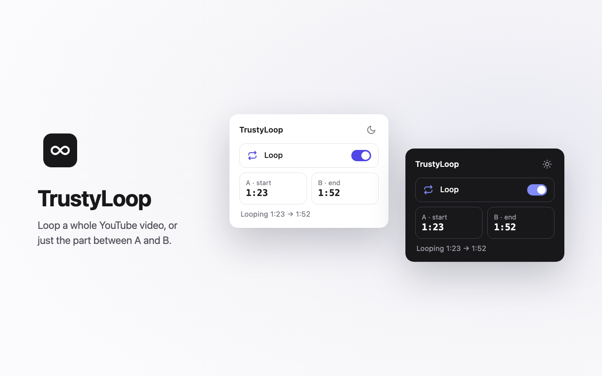
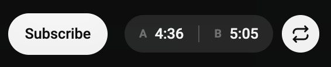

# TrustyLoop for YouTube

Loop a whole YouTube video, or just the part between A and B. Use it from the toolbar or from the controls right under the video.

## Install (Chrome or Brave)

1. Open `chrome://extensions` (Brave: `brave://extensions`) and turn on **Developer mode**.
2. Click **Load unpacked** and choose this folder.
3. Reload any YouTube tab that was already open.

## Use

**Under the video**, next to Subscribe:

- Click the **loop** button to repeat the whole video. **A | B** slides out to its left.
- Click **A** at the start of the part and **B** at its end: only that part repeats.
- Click the loop button again to stop everything.

**In the popup** (toolbar icon): the same controls, plus a light/dark toggle. Both stay in sync.

A new video starts without a loop. The controls under the video follow YouTube's own light or dark theme. On music.youtube.com they float above the player bar.

## Privacy

No network access, no analytics, nothing stored. It runs only on youtube.com and music.youtube.com.

## Files

| File | Job |
| --- | --- |
| `manifest.json` | Runs only on YouTube; no extra permissions |
| `content.js` | The loop logic and the controls under the video |
| `popup.html`, `popup.js` | The toolbar popup |
| `theme.js` | Light/dark toggle for the popup |

## License

Copyright (c) 2026 zkrogfoss. [MIT](LICENSE), without any warranty.
